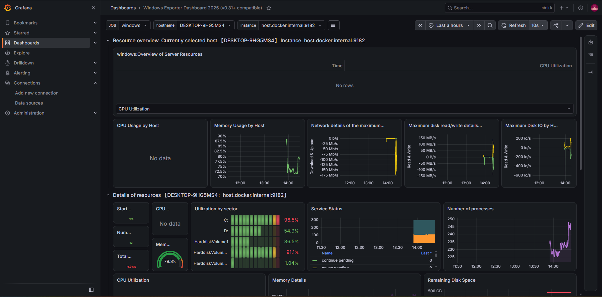

``Мониторинг Windows-хоста (Prometheus + Grafana)``

Учебный инфраструктурный проект. Система мониторинга для сбора метрик с Windows-хоста и их визуализации в реальном времени.

Технологии: 
 Prometheus - сбор и хранение метрик.
 Grafana - визуализация и дашборды.
 Windows Exporter - агент для сбора метрик Windows.
 Docker / Docker Compose - контейнеризация инфраструктуры.

Для запуска:

1. Установить Docker-desktop (https://www.docker.com/products/docker-desktop/).
2. Установить Windows Exporter (https://github.com/prometheus-community/windows_exporter/releases). Он запустится как служба Windows(9182).
3. В папке с проектом выполните команду:
   ```bash
   docker compose up -d
4. Открыть Prometheus: http://localhost:9090 
5. Открыть Grafana: http://localhost:3000 (логин:admin,пароль:admin).
6. Импорт дашборда с ID 23942 (Windows Exporter Dashboard 2025).

Скриношоты: 
1. Дашборд Grafana


2. Сбор данных в Prometheus

